<p align="center">
  <picture>
    <source media="(prefers-color-scheme: dark)" srcset=".github/readme/banner-dark.svg">
    
  </picture>
</p>

<p align="center">
  <b>A conversational chatbot for restaurant staff, with voice input and output.</b>
</p>

<p align="center">
  <a href="#run-it"><b>Run it</b></a> &nbsp;·&nbsp;
  <a href="#commands"><b>Commands</b></a> &nbsp;·&nbsp;
  <a href="#tests"><b>Tests</b></a>
</p>

<p align="center">
  <picture>
    <source media="(prefers-color-scheme: dark)" srcset=".github/readme/divider-dark.svg">
    
  </picture>
</p>

My final year project at the University of Westminster. Staff manage table reservations by typing or speaking, and ResBot handles bookings, cancellations and availability checks through a guided conversation.

### What it does

| Feature | How it works |
| --- | --- |
| **Reservations** | Book, cancel, check availability and list every booking |
| **Voice input** | Click the microphone, and the Google Speech API turns speech into text |
| **Voice output** | Replies are read aloud with pyttsx3, and can be muted at any time |
| **Settings** | Change the restaurant's name, opening hours and table layout |
| **Tests** | A suite of 62 unit tests |

### Run it

You need Python 3.

```bash
pip install SpeechRecognition pyttsx3
```

```bash
pip install pipwin && pipwin install pyaudio
```

```bash
python chatbot.py
```

### Commands

Type a command, or use the quick buttons at the bottom of the window.

| Command | What it does |
| --- | --- |
| `book` | Start a new table reservation |
| `cancel` | Cancel a booking by its reference number |
| `check` | See how many bookings exist on a date |
| `view` | List all current reservations |
| `help` | Show the commands and opening hours |

During any conversation, type `cancel`, `quit` or `start over` to go back to the main menu.

### Tests

```bash
python -m unittest test_chatbot -v
```

### Files

| File | What it holds |
| --- | --- |
| `chatbot.py` | The application: logic, interface and voice |
| `config.json` | Restaurant name, hours and tables |
| `reservations.json` | The reservation data, created on first run |
| `test_chatbot.py` | The unit tests |

---

<p align="center">
  <sub>Built by <a href="https://dequavious.dev"><b>Khaled Jamal</b></a>, known online as Dequavious. Founder of <a href="https://usehelm.host">Helm</a>.</sub>
</p>
